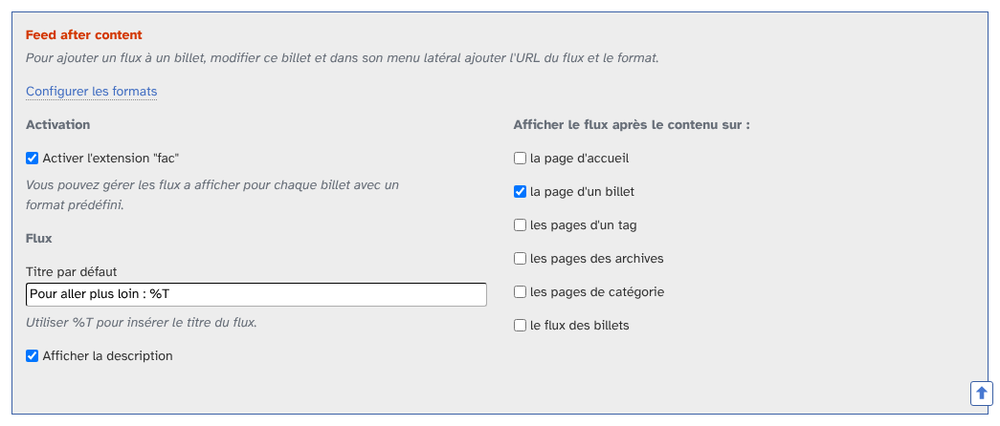
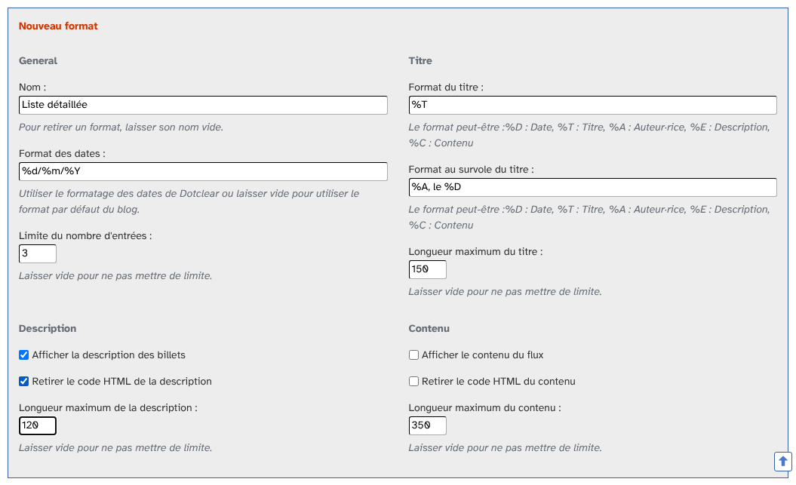
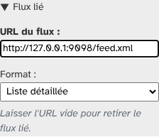
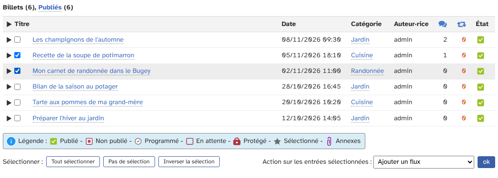
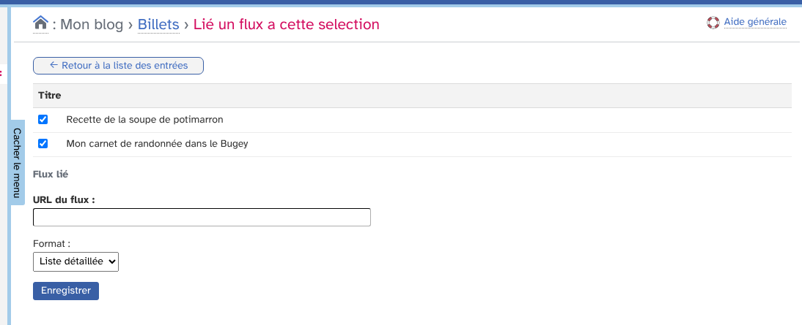
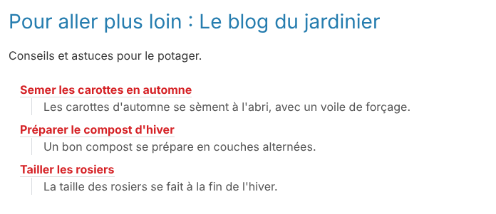

# Feed after content : guide d'utilisation

Feed after content (plugin `fac`) affiche, sous le contenu d'un billet, les derniers éléments d'un flux RSS ou Atom de votre choix : un autre blog, un site d'actualités, un dépôt de code… Le flux est choisi billet par billet, et l'affichage se règle par des « formats » que vous définissez.

Ce plugin n'a pas de page d'administration. Il a une page de configuration (les formats), des réglages dans les paramètres du blog et un menu dans la page d'édition des billets.

## Sommaire

1. [Ce qu'il faut avant de commencer](#ce-quil-faut-avant-de-commencer)
2. [Activer le plugin sur le blog](#activer-le-plugin-sur-le-blog)
3. [Créer un format](#créer-un-format)
4. [Lier un flux à un billet](#lier-un-flux-à-un-billet)
5. [Lier ou retirer un flux sur plusieurs billets](#lier-ou-retirer-un-flux-sur-plusieurs-billets)
6. [Ce que voient les visiteurs](#ce-que-voient-les-visiteurs)
7. [Bon à savoir](#bon-à-savoir)

## Ce qu'il faut avant de commencer

* Le thème du blog doit appeler l'emplacement `publicEntryAfterContent` après le contenu des billets (c'est le cas des thèmes de Dotclear).
* Pour créer des formats, il faut être super-administrateur. Pour régler le plugin sur le blog, être administrateur du blog. Pour lier un flux à un billet, avoir les droits d'écriture sur les billets.
* Le serveur doit pouvoir lire l'adresse du flux.

## Activer le plugin sur le blog

Allez dans **Blog > Paramètres du blog**, puis ouvrez la section **Paramètres des plugins pour ce blog**. Le bloc **Feed after content** propose :

* **Activer l'extension "fac"** : interrupteur général.
* **Titre par défaut** : le titre placé au-dessus du flux. `%T` est remplacé par le titre du flux. Laissez vide pour n'afficher aucun titre.
* **Afficher la description** : ajoute la description du flux sous le titre.
* **Afficher le flux après le contenu sur** : les pages où le flux apparaît : accueil, page d'un billet, pages des tags, des archives, des catégories, flux des billets. Si le plugin muppet est installé, ses types de pages sont aussi proposés.

Le lien **Configurer les formats** mène à la configuration du plugin.

## Créer un format

Un format décide de l'aspect de la liste : combien d'éléments, quel texte, quelle longueur. Allez dans **Système > Gestion des plugins**, trouvez **Feed after content** et cliquez sur **Configurer**.

La page propose un bloc **Nouveau format** :

**Général**

* **Nom** : le nom du format, tel qu'il apparaîtra dans le menu des billets. Pour supprimer un format, videz son nom.
* **Format des dates** : le format de date de Dotclear, par exemple `%d/%m/%Y`. Vide : le format de date du blog.
* **Limite du nombre d'entrées** : combien d'éléments du flux afficher. Comme pour les longueurs, laissez vide pour ne pas limiter.

**Titre**

* **Format du titre** : le texte du lien de chaque élément. On peut utiliser `%D` (date), `%T` (titre), `%A` (auteur), `%E` (description) et `%C` (contenu). Par défaut : `%T`.
* **Format au survol du titre** : le texte de l'infobulle du lien, avec les mêmes codes. Par défaut : `%D`.
* **Longueur maximum du titre** : coupe le titre.

**Description** et **Contenu**

* **Afficher la description des billets** / **Afficher le contenu du flux** : ajoute le texte de l'élément sous son titre.
* **Retirer le code HTML…** : supprime les balises HTML du texte.
* **Longueur maximum…** : coupe le texte.

Cliquez sur **Enregistrer** pour garder les formats.

## Lier un flux à un billet

1. Ouvrez le billet dans l'administration.
2. Dans le menu latéral, ouvrez **Flux lié**.
3. Collez l'**URL du flux** et choisissez le **Format**.
4. Enregistrez le billet.

Pour retirer le flux, videz le champ de l'adresse puis enregistrez le billet. L'action de masse « Retirer un flux », décrite ci-dessous, le fait pour plusieurs billets à la fois.

## Lier ou retirer un flux sur plusieurs billets

Dans la liste des billets, cochez plusieurs billets, puis choisissez dans la liste d'actions **Flux lié > Ajouter un flux** ou **Flux lié > Retirer un flux**.

Pour ajouter, une page demande l'URL du flux et le format, qui sont appliqués à tous les billets cochés.

## Ce que voient les visiteurs

Sous le contenu du billet, le plugin affiche :

* le titre du flux (selon **Titre par défaut**) et sa description (selon **Afficher la description**) ;
* la liste des éléments du flux, chacun avec un lien vers l'article d'origine. L'infobulle du lien suit le **Format au survol du titre**, et le texte de l'élément s'affiche si vous l'avez demandé.

Le tout est dans un bloc `
` que vous pouvez habiller en CSS.

## Bon à savoir

* **Si l'on décoche tous les types de pages**, le plugin ne s'affiche plus nulle part.
* **Le HTML du flux distant est toujours nettoyé** : même si « Retirer le code HTML » n'est pas coché, les balises dangereuses sont retirées avant l'affichage.
* **Flux injoignable** : si le flux ne répond pas ou n'est pas valide, rien n'est affiché sous le billet, sans message d'erreur.
